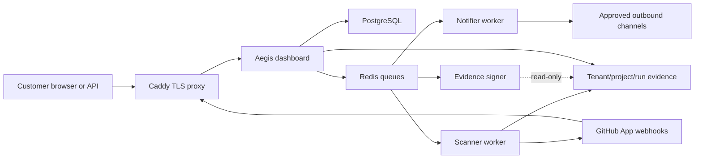

# Architecture and data flow

The supported commercial topology is one customer per isolated deployment.
Caddy terminates TLS. The dashboard authenticates users and authorizes projects.
PostgreSQL stores identity, project, scan and audit metadata. Redis transports
jobs. Scanner workers process hostile source and write signed evidence. A
separate notifier worker owns outbound delivery credentials.

PostgreSQL connections use a process-local native pool with at most four
connections and five-second connection/acquisition limits. Transactions finish
before connections return to the pool. Dashboard shutdown closes the pool;
RQ forks close idle pooled connections before starting a job.

Scan history reads compact summaries instead of complete scanner reports.
Schema migration 22 adds those summaries and backfills existing results in
batches of 100 without replacing the original results or signed artifacts.
Upgrade the dashboard and workers together so completed scans write summaries.

The findings endpoint returns bounded pages, filtered totals, and project-wide
open/blocker counts. Search and filtering happen before pagination. Open counts
include accepted risk and exclude resolved/false-positive findings; blockers
also exclude BAC research findings. Finding reconciliation serializes each
project's writes and loads prior coverage once per relevant scan.

Quick runs Ruff security rules and detect-secrets. Standard adds Semgrep, with
Aegis-owned rules for Python, JavaScript/TypeScript, Go, and Java, and OSV. YARA is optional. CodeQL is the opt-in Deep source analyzer for Python and
JavaScript/TypeScript. A dedicated Compose worker streams admitted source into
an offline, unprivileged CodeQL child container; the child receives no host
filesystem mount or application credentials. Removed
Checkov, Safety, ClamAV, Trivy, and DAST results remain readable as historical
evidence. New scan decisions do not claim infrastructure, container, malware,
or runtime testing from CodeQL.

Scanner workers do not hold the evidence-signing key. A worker submits the
unsigned manifest to the `evidence-signing` queue; the signer process, which
holds the key and mounts evidence read-only, signs only when the run exists and
is still in progress, has never been signed before (an append-only
`evidence_signatures` ledger), every artifact hash matches the stored bytes, and
the source descriptor matches the manifest's attestation.

Current scanner workers require database access and GitHub App credentials to
clone private repositories and complete checks. The target regulated topology
replaces this with a credential broker and ephemeral scanner runtime receiving
only a short-lived source lease and evidence-upload capability. Immutable object
storage, KMS keys, OIDC, and external SIEM are also target-state controls, not
features of the local backend.
